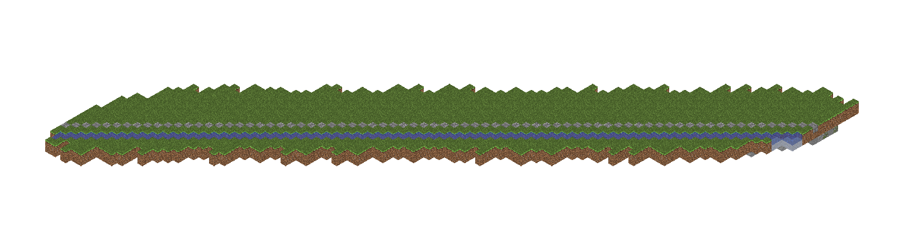
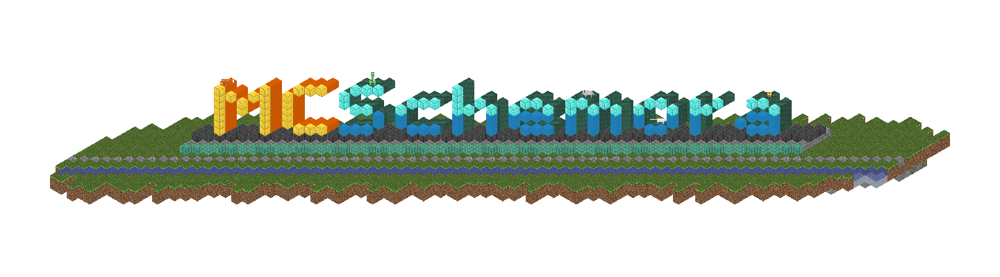
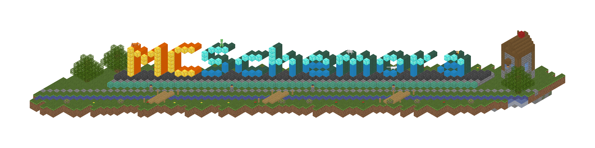

# Island banner

Build the scene at the top of the documentation homepage: an island sized around
a row of block letters, with paths, trees, a tower, and animals. The generator
builds the terrain first, then places the lettering and details on top.

With [uv](https://docs.astral.sh/uv/getting-started/installation/) installed,
[download banner.py](downloads/banner.py) and run:

```sh
uv run --with mcschemora banner.py
```

The script writes `output/banner.schem` and a 3840 × 960 `output/banner.png`
for Java 1.21.1. Pass `--output another-folder` to keep a variant separately.

## Lettered island

The generator stores placements in a `cells` dictionary, allowing later details
to replace earlier blocks at the same position. The `put` helper converts layout
depth into Z:

```python
--8<-- "examples/banner.py:29:30"
```

Grass over dirt forms the top of the island. Narrower stone and deepslate layers
taper its underside, while a fixed random seed roughens the outline. A strip of
clay and source water makes a channel through the top.



The lettering determines the island's width. Each character in `GLYPHS` has seven
rows of zeroes and ones, with a `1` marking a block; the generator measures the
text, then advances a cursor as it places each glyph:

```python
--8<-- "examples/banner.py:67:78"
```

Gold faces with orange-concrete backs form the first two letters. The remaining
letters have diamond or light-blue concrete faces and dark-prismarine backs.
Two extra depth layers give them thickness, and a raised stone and deepslate
platform supports them.



To change the text, choose characters already in `GLYPHS` or add a seven-row
bitmap for each new character. The island width follows the new text width.

## Structures

A path runs along one depth coordinate, with lanterns twelve blocks apart and
small slab bridges over the water channel. Trees have log columns and several
leaf layers; skipped corner blocks soften their outlines.

The tower uses a local placement helper to build near the end of the lettering:

```python
--8<-- "examples/banner.py:122:125"
```

Its 5 × 5 footprint has cobblestone lower walls and logs at the upper corners.
Stairs face inward from either side to form a pitched roof. A paired door,
windows, a lantern, and a flag finish the building. When changing those
materials, inspect their [block states](../sdk/schematics.md#block-states) to
keep directional pieces facing correctly.

## Rendering

The script adds mobs through `region.entities.add(mob(...), at=...)`.
Fractional entity positions let it center animals on blocks. Some perch on the
letters, while a sheep and pig stand on the island.

After writing the final block batch, the entry point saves the schematic and
calls `export_png`. Check the render diagnostics when comparing the image with
the build: the current visual bundle can report missing chicken and pig textures
and sheep fur geometry. Those entities remain in the schematic.

For a variant, replace the tower with your own building or change the lettering
materials while keeping the layout fixed.

<details markdown="1">
<summary>Read the complete script</summary>

```python title="banner.py"
--8<-- "examples/banner.py"
```

</details>



[Download the schematic](../assets/examples/banner.schem){ .md-button }
[Download the PNG](../assets/examples/banner.png){ .md-button }
