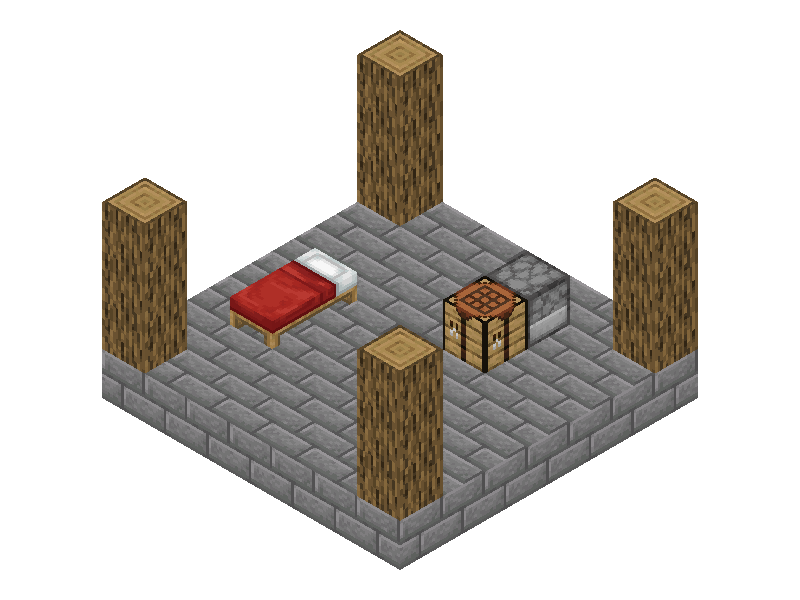
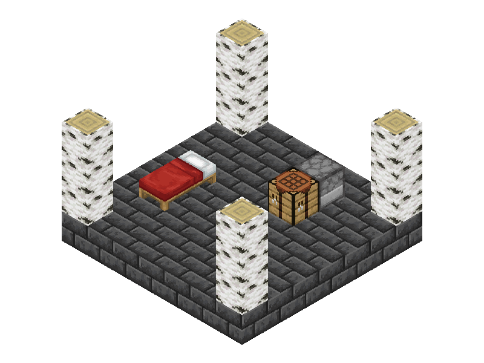

# Compare palette costs

Compare the ingredient requirements and estimated value of the same workshop
before and after changing oak and stone to birch and deepslate. Both reports use
Java 1.21.1 with the same bundled recipes and valuation profiles, so you can
trace a cost change back to the materials being replaced.

Download [restyle.py](downloads/restyle.py),
[workshop_palette.json](downloads/workshop_palette.json), and
[workshop.schem](../assets/examples/workshop.schem), then run:

```sh
uv run --with mcschemora restyle.py workshop.schem workshop_palette.json --output output/comparison
```

## Missing prices

Read each priced total together with its unpriced ingredients. The EMC profile
prices both raw-ingredient sets completely; EssentialsX leaves gaps in both:

| Profile | Original priced total | Restyled priced total | Interpretation |
| --- | ---: | ---: | --- |
| EMC | 1101 | 1150 | Both raw-ingredient sets are fully priced by this profile. |
| EssentialsX | 147 | 0 | Both have missing prices; the restyled total is not its full value. |

The original EssentialsX report leaves beetroot, cobbled deepslate, oak logs, and
white wool unpriced. The restyled report also contains unpriced birch logs and
more cobbled deepslate. Check the `unpriced` dictionaries alongside the totals
before using them to choose materials.

The JSON keeps complete construction and raw-material reports under `before`
and `after`, along with normalization and import/render diagnostics. It compares
the supplied palettes without estimating gathering time or automatically
optimizing materials. [Download comparison.json](../assets/examples/restyled/comparison.json)
to inspect those fields.

See [restyle a workshop](restyle-workshop.md#script) for the shared script. The
[valuation documentation](../sdk/materials-and-costs.md#valuation) explains the
profiles used in these reports.

Open `comparison.json` and compare the previews to confirm the palette change:

| Original | Restyled |
| --- | --- |
|  |  |
