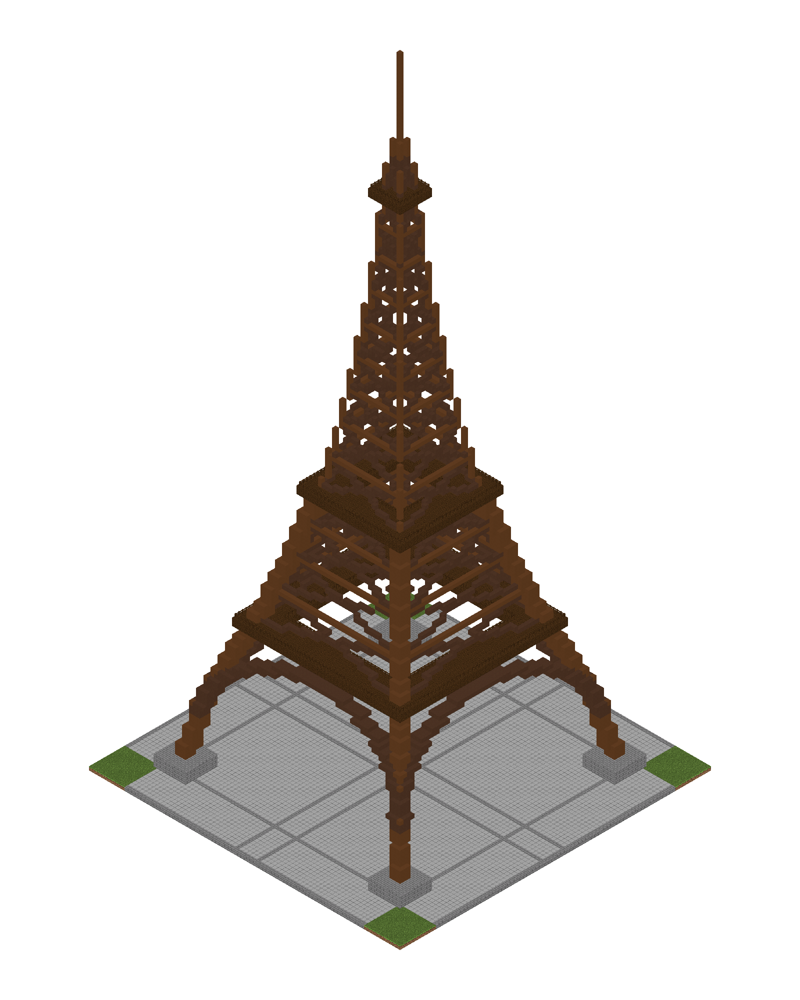

# Eiffel Tower

Ask your agent to write the build for you:

> Create a recognizable Minecraft Eiffel Tower with four splayed legs, arches
> beneath the first platform, a tapering lattice shaft, observation platforms,
> and an antenna. Place it on a stone plaza. Write a deterministic Python script
> using MCSchemora, validate the result, save a WorldEdit schematic, and render
> a transparent PNG.

For your own generation loop, give your agent the
[full SDK documentation](../llms.txt) and follow the
[agent quickstart](../quickstart/agents.md).

<details markdown="1">
<summary>Read the generated file from gpt-sol-6.1</summary>

```python title="eiffel_tower.py"
--8<-- "examples/eiffel_tower.py"
```

</details>



[Download the schematic](../assets/examples/eiffel-tower/eiffel-tower.schem){ .md-button }
[Download the PNG](../assets/examples/eiffel-tower/preview.png){ .md-button }
