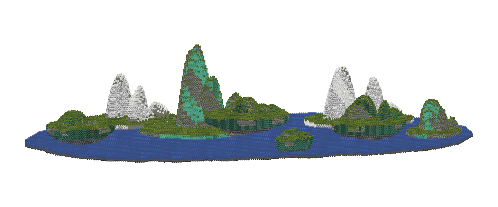
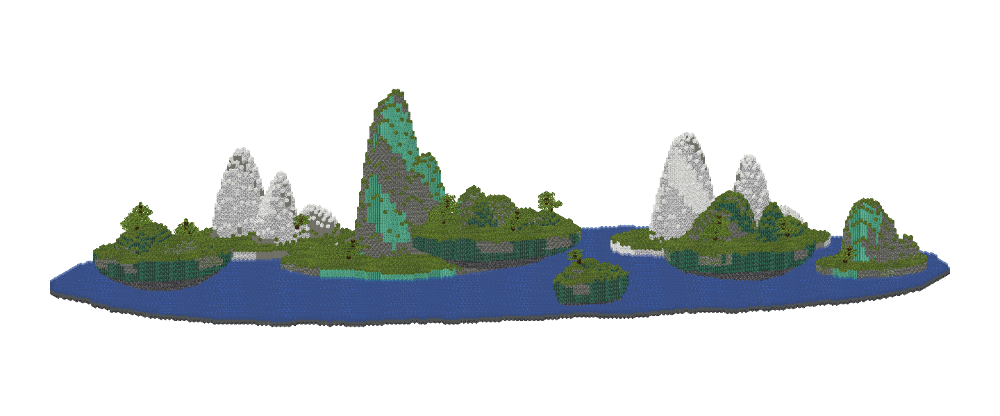
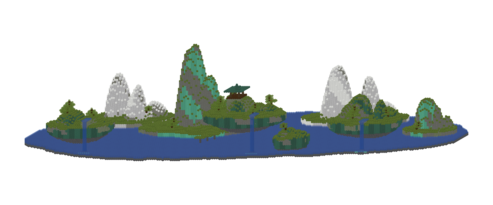

# Jade mountain scroll

Generate layered mountains above a long strip of water, then use their surface
heights to place pine trees, waterfalls, and a small pavilion. Seeded noise
breaks up the slopes. The composition draws on shan shui painting and
[Lingdong Huang's generative landscapes](https://shan-shui-inf.lingdong.works/).

With [uv](https://docs.astral.sh/uv/getting-started/installation/) installed,
[download jade_scroll.py](downloads/jade_scroll.py) and run:

```sh
uv run --with mcschemora jade_scroll.py
```

The script saves `output/jade-scroll.schem` and a 3840 × 1600
`output/jade-scroll.png`. The published build uses seed 42. Both the noise
permutation and other random choices use `seed`, so hold it fixed to compare
material or detail changes on the same terrain. To try a different layout with
the same palette and details, save a second version:

```sh
uv run --with mcschemora jade_scroll.py --seed 17 --output scroll-17
```

## Terrain

The generator stores blocks by position in `cells`; writing a coordinate again
replaces its earlier material. A helper maps layout coordinates to Minecraft:

```python
--8<-- "examples/jade_scroll.py:58:59"
```

The layout uses `depth` before the `depth - x` shift determines final Z. The
`material` helper caches block descriptions by ID and properties, letting repeated
placements reuse values.

Construction starts with a long strip of water. A sine wave bends its center,
noise roughens its tapered outline, and deepslate and cyan terracotta form two
bed layers underneath:

```python
--8<-- "examples/jade_scroll.py:61:68"
```

Each island specifies a center, two radii, a base height, a peak height, and a
depth layer. The generator checks an elliptical outline for each column,
combines three peaks with noise, and fills from bottom to top. Recording
`surfaces[(x, depth)] = top` gives the later details a height map to follow.

The rock palettes separate the mountain layers:

```python
--8<-- "examples/jade_scroll.py:80:84"
```

Pale calcite and diorite form distant peaks, copper and tuff fill the middle,
and darker prismarine and mossy stone sit nearest the viewer.



## Trees

The `pine` helper reads the terrain height to place a spruce trunk. Shifting the
upper half one block gives it a lean; tapering tiers of azalea leaves form the
canopy:

```python
--8<-- "examples/jade_scroll.py:143:159"
```

`persistent=True` keeps these generated leaves from depending on Minecraft's
leaf-decay distance rules. Change the coordinate list below the function to move
trees or alter their heights without changing the mountains.



## Finishing the scene

The waterfall helper follows the surface map toward an island's edge. It chooses
a level across the stream's width, fills gaps beneath it with mossy cobblestone,
and places source water on top. At the edge, two falling-water columns extend
toward the pool:

```python
--8<-- "examples/jade_scroll.py:193:201"
```

`level=0` marks source water upstream, and `level=8` marks falling water in the
columns. These are authored states; the script does not simulate fluid ticks.


The pavilion sits above the highest ground in its 7 × 7 footprint, with mossy
cobblestone filling the gaps underneath. Four dark-oak posts support a roof that
falls with distance from its center. An extra block at the outer edge lifts
the eaves.

After adding three small stepping islands, the generator writes the completed
dictionary with `schematic.region().set_many(cells.items())`. The entry point
saves the schematic and renders the finished scroll. Try moving a tree, changing
a rock palette, or adding a second pavilion. Use
[render crops](../sdk/rendering.md) to inspect details hidden behind the mountains.

<details markdown="1">
<summary>Read the complete script</summary>

```python title="jade_scroll.py"
--8<-- "examples/jade_scroll.py"
```

</details>



[Download the schematic](../assets/examples/jade-scroll.schem){ .md-button }
[Download the PNG](../assets/examples/jade-scroll.png){ .md-button }
