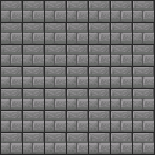

# Layer diagrams

Export the workshop as five numbered grids of block sprites, covering Y=0
through Y=4. A JSON manifest ties each image to its global Y coordinate and
records its diagnostics, so you can follow the layers even when a build sits
above or below zero.

Download [layers.py](downloads/layers.py) and
[workshop.schem](../assets/examples/workshop.schem), then run:

```sh
uv run --with mcschemora layers.py workshop.schem --output output/layers
```

The command confirms the number of layers and the manifest location:

```text
Saved 5 layer diagrams and layers.json to output/layers
```

Sprite diagrams use bundled Wiki icons, so they do not download
the native texture/model bundle. Imported Java blocks still need their catalogs.

## Layer coordinates

Each region has local bounds. The script uses `to_global(bounds.start)` to find
its bottom layer in the schematic, then walks from the lowest to the highest
global Y coordinate. That includes empty gaps between regions, so check the
vertical range before running it on a large build. Resolve conflicting region
overlaps before rendering as well.

```python title="layers.py"
--8<-- "examples/layers.py"
```

Layer diagnostics describe omitted states and inventory details; retain the
source schematic to preserve those fields. See
[rendering and blueprints](../sdk/rendering.md#layer-guides) for custom icons,
cardinal views, and textured layer alternatives.



[Download all five layers and the manifest](../assets/examples/layers.zip) to
inspect the guide.
