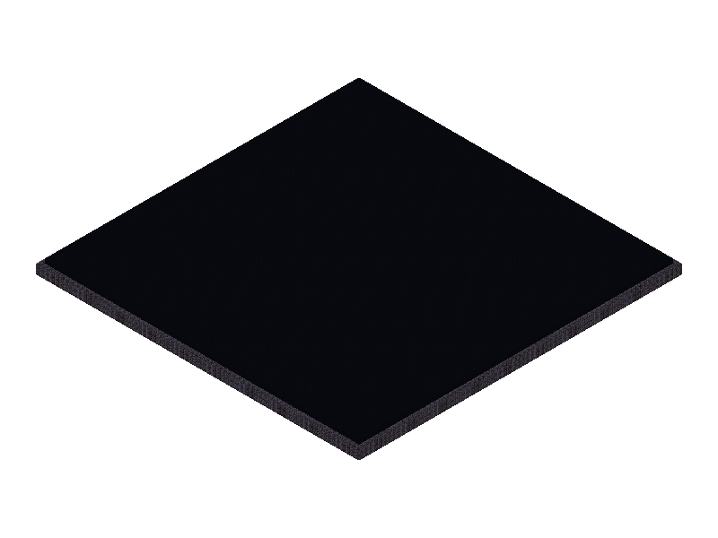
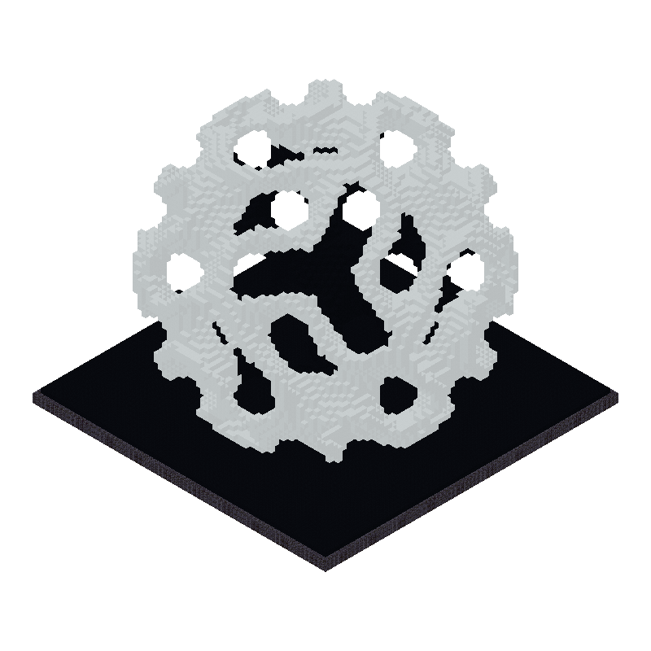
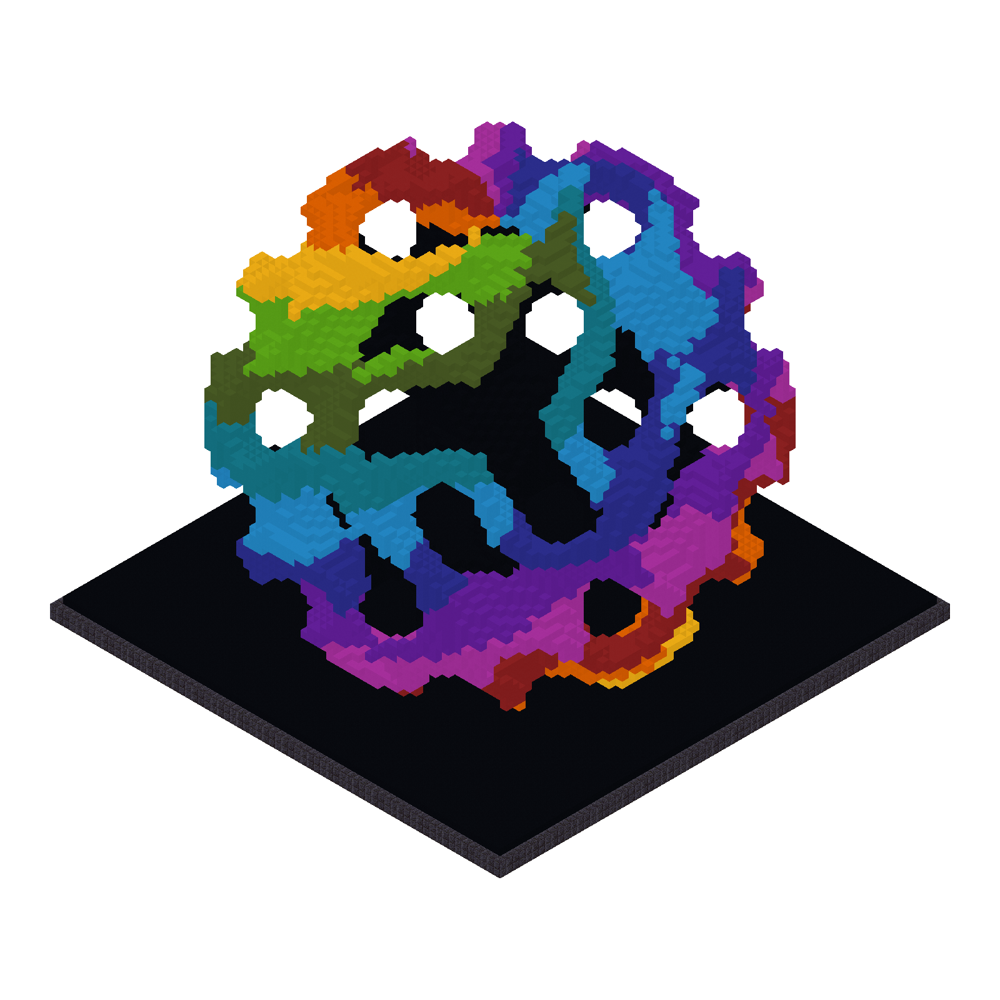

# Rainbow reef

Sample a gyroid surface inside a sphere, give it a dark core, and color its outer
shell with a rainbow. The open channels expose the core behind the colors; a
blackstone plinth supports the clipped lower edge.

With [uv](https://docs.astral.sh/uv/getting-started/installation/) installed,
[download reef.py](downloads/reef.py) and run:

```sh
uv run --with mcschemora reef.py
```

The script writes `output/reef.schem` and a 1600 × 1600 `output/reef.png`.
The default sphere is 64 blocks across with 2.5 surface repetitions and thickness
0.35. Edit the downloaded file to change its geometry or colors.

## Geometry

`placements()` yields `(position, block)` pairs, starting with two layers of
polished blackstone and a narrower black-concrete deck:

```python
--8<-- "examples/reef.py:49:53"
```

At diameter 64, the blackstone extends from -3 through 66 on X and Z. The `margin`
shrinks the top layer by one block on each side.



Above the plinth, a gyroid forms a repeating surface with channels passing through
it. The script evaluates this field using scaled coordinates `u`, `v`, and `w`:

```text
sin(u) × cos(w) + sin(v) × cos(u) + sin(w) × cos(v)
```

Positions close enough to zero belong to the surface. The `thickness` threshold
controls that band: lower values leave thinner walls and wider channels.
To fit `periods` repetitions across the diameter, the generator centers and scales
the sampling grid. Each coordinate's square, sine, and cosine are calculated
once for reuse in the inner loops:

```python
--8<-- "examples/reef.py:33:45"
```

The loops clip the field to a sphere by comparing squared distance from the
center with `radius_squared`, skipping positions outside it. Cutting off the
lower part lets the reef sit on its plinth.



White concrete in place of the exterior colors makes the channels easier to
inspect before choosing a palette.

## Color

`atan2` gives the angle around the vertical axis. A height-dependent twist
shifts the palette as the surface rises, and modulo wraps the result into a
single cycle before conversion to a palette index:

```python
--8<-- "examples/reef.py:60:68"
```

Cells within 80% of the sphere's radius use black concrete. The palette colors
the remaining shell, leaving dark channels behind it. Edit `COLORS` at the top
of the downloaded file to use another set of concrete colors.

After yielding the base and surface, the generator writes all placements in one
batch:

```python
--8<-- "examples/reef.py:70:71"
```

The entry point saves the schematic and calls `export_png`. See
[building](../sdk/schematics.md#batch-writes) for more on batches and palettes.

## Change the shape

Try a smaller reef with thinner walls, saving it separately:

```sh
uv run --with mcschemora reef.py --diameter 48 --periods 2 --thickness 0.25 --output small-reef
```

| Option | What changes | Accepted values |
| --- | --- | --- |
| `--diameter` | Sphere size in blocks. | 16 through 128 |
| `--periods` | Surface repetitions across the diameter. | 1 through diameter / 8 |
| `--thickness` | Width of the solid band around the surface. | Greater than 0 and less than 1 |

<details markdown="1">
<summary>Read the complete script</summary>

```python title="reef.py"
--8<-- "examples/reef.py"
```

</details>



[Download the schematic](../assets/examples/reef.schem){ .md-button }
[Download the PNG](../assets/examples/reef.png){ .md-button }
