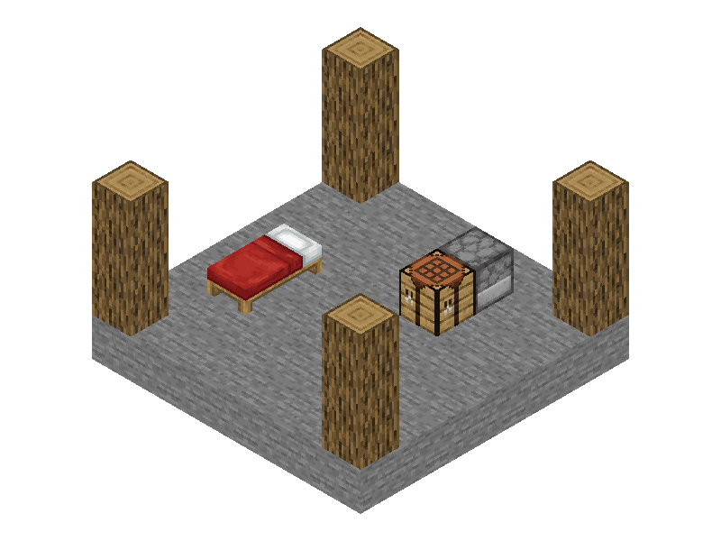

# Replace blocks

Replace the workshop's 49 stone-brick floor cells with ordinary stone. A
normalization profile matches block IDs throughout the build, so you can use it
for unwanted blocks you cannot find in an in-game overlay.

Download [restyle.py](downloads/restyle.py),
[stone_palette.json](downloads/stone_palette.json), and
[workshop.schem](../assets/examples/workshop.schem). The profile changes only
stone bricks; it has no fallback, so unlisted materials stay unchanged:

```json title="stone_palette.json"
--8<-- "examples/stone_palette.json"
```

Apply it to the workshop:

```sh
uv run --with mcschemora restyle.py workshop.schem stone_palette.json --output output/replaced
```

The script reports 49 replacements, validates the result, and writes a separate
Litematica file, before/after PNGs, and a cost comparison.

Before adapting the shared [script](restyle-workshop.md#script), adjust
its cutaway crop for your build; the supplied crop fits this workshop.

## States and removal

For another input, inspect [palette counts](../sdk/palettes.md#count-block-states)
to find the IDs and orientation variants. Normalization preserves compatible
target properties, but an incompatible change such as chest to stone can be
skipped. The report does not explain every skipped cell, so compare the counts
and inspect the result.

To clear ordinary blocks, select them and fill with air:

```python
from mcschemora import Schematic, block

scene = Schematic.load("workshop.schem")
region = scene.region()
region.select(start=(0, 0, 0), size=(7, 5, 7)).select(block="stone_bricks").fill(block("air"))
```

The snippet edits only the in-memory scene. Review it before saving;
`delete()` additionally removes selected entities. See
[selection semantics](../sdk/editing.md#entities-and-deletion) when choosing
between those operations.



[Download the result](../assets/examples/replaced/restyled.litematic) to inspect
the floor.
