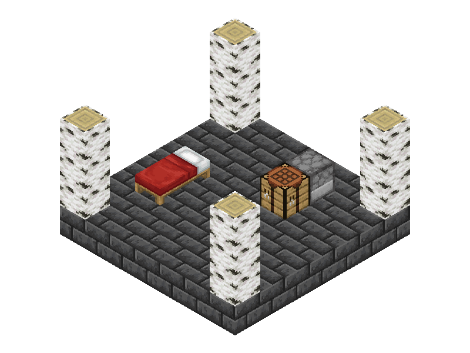

# Restyle a workshop

Change the workshop's oak pillars and slabs to birch and its stone-brick floor
to deepslate bricks with a reusable JSON profile. The supplied profile changes
110 blocks while keeping the bed, furnace, and inventory chest. Compatible states,
including vertical log axes and bottom-slab placement, survive the restyle.

## Profile

Save [restyle.py](downloads/restyle.py),
[workshop_palette.json](downloads/workshop_palette.json), and
[workshop.schem](../assets/examples/workshop.schem) together. Review the profile
before running it:

```json title="workshop_palette.json"
--8<-- "examples/workshop_palette.json"
```

IDs listed in `keep` are protected. Each replacement group changes its source
IDs to the target; with `fallback` omitted, every other material stays unchanged.
Normalization retains compatible properties across orientations. Run the profile
against the supplied workshop:

```sh
uv run --with mcschemora restyle.py workshop.schem workshop_palette.json --output output/restyled
```

Validation prints `No issues found.` and the changed count is 110. The script
leaves the source unchanged and writes `before.png`, `after.png`,
`restyled.litematic`, and `comparison.json`. Compare the changed count and the
before/after palette counts to find any skipped replacements.

Rendering downloads visual assets on first use and uses the shared
Java 1.21.6 visual bundle; check its diagnostics when trying other inputs.

## Script

The script calculates the original costs and renders a cutaway before applying
the profile. It then validates, calculates the new costs, and exports the separate
build and preview. Adjust the Y=0..3 crop when using a build with a different roof
height:

```python title="restyle.py"
--8<-- "examples/restyle.py"
```

Continue with [compare palette costs](compare-palettes.md) to interpret the
report, or read about [custom profiles and rule precedence](../sdk/palettes.md#profiles)
to change how materials are selected.



[Download the restyled schematic](../assets/examples/restyled/restyled.litematic)
and [comparison report](../assets/examples/restyled/comparison.json) to inspect
the result.
