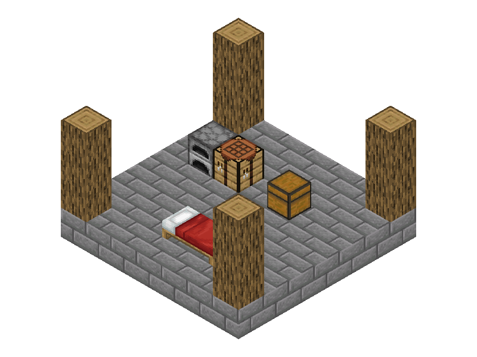

# Rotate a schematic

Rotate the supplied workshop by one quarter turn around Y and save its new block
positions and states. The rotation remains when you load the file in another
importer, and inventory data moves with its chest.

Download [rotate.py](downloads/rotate.py) and
[workshop.schem](../assets/examples/workshop.schem), then run:

```sh
uv run --with mcschemora rotate.py workshop.schem --output output/rotated
```

Validation prints `No issues found.` and the script writes `rotated.litematic`
and `rotated.png`. Positive steps turn north toward west, so check that the
workshop's west-facing furnace now faces south. The preview crops the workshop
at global Y=0..3.

## Script

The script selects the region's complete bounds and rotates about their geometric
center. It accepts one region; an assembled multi-region build would need a
shared pivot:

```python title="rotate.py"
--8<-- "examples/rotate.py"
```

To mirror instead, use `area.flip(axis="x")`
or `area.flip(axis="z")`, then inspect directional states and any diagnostics.
See [transformation behavior](../sdk/editing.md#collisions) for pivots, collision
checks, selected air, and unsupported transforms.



[Download rotated.litematic](../assets/examples/rotated/rotated.litematic) to
inspect the saved transformation.
