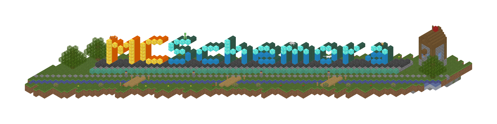

# MCSchemora

MCSchemora is a Minecraft schematic SDK designed to be a simple and fast interface to programmatically create Minecraft schematics.



## Why MCSchemora?

Minecraft schematic libraries have traditionally been extremely fragmented, where often tools are directly hosted on closed webpages that require tons of jumping around. Furthermore, existing authoring interfaces tend to be quite difficult to work with, especially for agents who require clean and well documented interfaces that can handle all the small intricacies and weirdness of Minecraft blocks.

MCSchemora is designed to address these issues by abstracting away all the engineering, cataloging, and authoring finnickiness to allow developers and agents to easily examine, edit, and deploy Minecraft schematics. By keeping the core interface and functionality small and Pythonic, MCSchemora can better support different agentic harnesses that don't need to learn specialized conventions to use the system while also easily integrating with existing packages that might be more familiar.

## MCSchemora for agents

The full documentation is available as Markdown in [llms.txt](llms.txt), generated
from the same sources as this website on every build. It includes the quickstarts,
MCSchemora chapters, examples with their code, and API references.

For example, paste the documentation with this prompt:

```text
Documentation:
{paste the contents of llms.txt here}
---
Using this documentation, write a Python script that loads a Litematica build,
replaces oak materials with birch while preserving compatible block states,
compares the raw-material estimates, and saves a new schematic and PNG preview.
Report changed blocks, replacements you could not verify, and export/render diagnostics.
Use the installed package's signatures if its version differs from these docs.
```

You can use the same format for API questions: replace the build request with
your question. The [agent quickstart](quickstart/agents.md#use-the-full-documentation)
explains how to combine the documentation with local API inspection.
