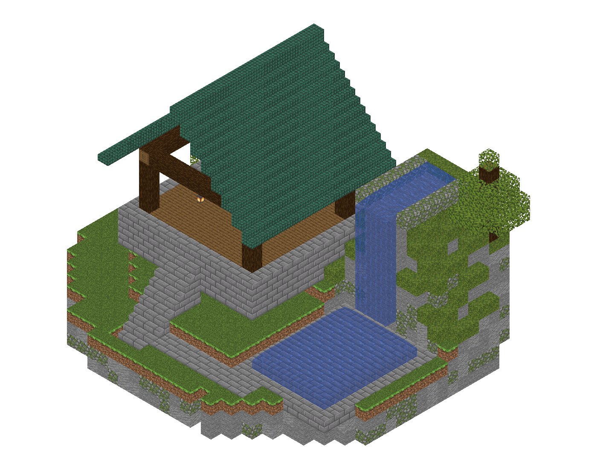

# Agent quickstart

Give your coding agent the setup prompt below, then describe the build or edit
you want. It can use MCSchemora to write blocks in a reproducible script, inspect
errors, and render the result. The pavilion on this page was built that way.
Read [why MCSchemora](../index.md#why-mcschemora) for the workflow, or give the
agent the full documentation before starting.

## Use the full documentation

[llms.txt](../llms.txt) contains the documentation as one Markdown file, including
the API references and expanded example code. It is generated with each website
build. Download it and attach or paste it into your assistant's context in Cursor,
Windsurf, GitHub Copilot, Claude, or another tool.

For a documentation question, use:

```text
Documentation:
{paste the contents of llms.txt here}
---
Based on this documentation, how do I apply a reusable material profile across
all regions without resetting compatible block states? Show the Python API calls
and explain how to check which replacements occurred.
```

For a build request, put the dimensions, Minecraft version, material palette, and
required output files after the documentation. The setup prompt below adds the
validation, rendering, and export checks. If the full file exceeds your tool's
context limit, include the relevant SDK chapter and API section instead.

The bundle matches the website build, so check the installed package's
signatures and docstrings if you are using a different version. The file gives
the agent API reference material; inspecting a preview still requires an image tool.

## Setup

```text
Set up MCSchemora in this project and learn its API before working on my
Minecraft build request. Use uv for Python setup and execution.

Inspect the project first. If it already declares mcschemora, run uv sync.
For an existing uv project without it, run uv add mcschemora. In an empty
directory, start with:
    uv init --python 3.12
    uv add mcschemora
Run Python scripts with uv run script.py.

Read https://tiltedlabs-ai.github.io/mcschemora/llms.txt for the full SDK docs
and examples. If it exceeds your context limit, use the relevant chapters and
https://tiltedlabs-ai.github.io/mcschemora/reference/python/ instead. Check
installed signatures and docstrings when a method is uncertain. The installed
package is authoritative if its version differs from the website.

Use this object model:
- Schematic.create(version="1.21.1") starts a new Java build. Pin the version
  requested by the user. Schematic.load(path) opens an existing file.
- scene.region() returns the default named region. Its block positions are
  local (x, y, z), with Y pointing up. Region origins place them globally.
- block("stone_bricks") describes a block. Properties such as facing or axis
  depend on that block and the selected Minecraft version. Query supported
  properties with scene.registry.describe("block_name") before guessing.
- region.set(position, block) writes one cell. select(start=..., size=...)
  selects a box by cell counts; fill(block) edits its cells. set_many accepts
  a mapping or iterable of (position, block) pairs for generated geometry.
- Use placement helpers for beds, doors, signs, and inventory chests. Blocks,
  free entities, and attached block-entity data have separate APIs.

Before editing, establish the input file or requested dimensions, Minecraft
version, materials, and output paths. Keep randomness seeded and the build
reproducible in a standalone script. Preserve input files unless the user
asked to replace them.

After changes, run scene.validate() and read its errors, warnings, and unknown
checks. Fix errors; inspect changes and skipped reasons if using repair().
Render a preview with scene.export_png(...) and read its diagnostics. Open
the image if your tools support it, check the requested details, and revise.
Validation does not simulate ticks, and a render does not prove that a farm
or redstone machine works.

Before saving, check scene.check_export(format="schem") or the requested
format. Resolve errors and review any losses. Save with scene.save(path).
Use .litematic to retain named regions. Create output directories first.

Deliver the script, schematic, and PNG with the Minecraft version, validation
result, and unresolved export/render diagnostics. Say whether you inspected
the image. When setup is ready, continue with the user's build request.
```

## Build a schematic

```text
Build a mountain pavilion for Minecraft Java 1.21.1 within 32 × 24 × 32 blocks.
Use spruce, stone bricks, and dark prismarine. Add a raised floor, an entrance,
a pitched roof, a path, and a waterfall with surrounding terrain.

Write a standalone agent_pavilion.py that recreates it. Save pavilion.schem
and pavilion.png in output/. Keep randomness seeded, validate the build, and
inspect the rendered image before delivering the files.
```

## Review the result

The subagent produced a 29 × 20 × 28 build containing 4,004 non-air blocks.
After inspecting the PNG and a render diagnostic, it revised the foliage.
The final validation, export checks, and render diagnostics reported no issues.

To reproduce it, download the script below. In the uv project you set up, run:

```sh
uv run agent_pavilion.py
```

## Result

[Download the build script](../examples/downloads/agent_pavilion.py){ .md-button }
[Download the schematic](../assets/examples/agent-pavilion.schem){ .md-button }


