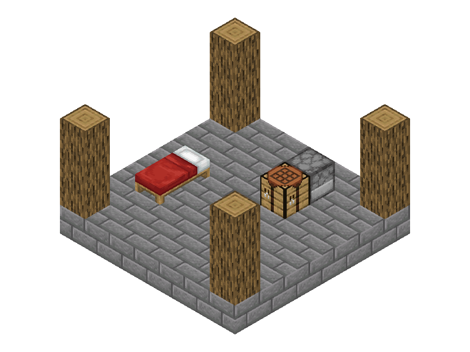

# Developer quickstart

Build a small workshop, save it as a schematic, and render a cutaway of its
interior. Keeping the build in a script lets you recreate it with different
materials or dimensions. MCSchemora handles versioned block states, paired
placements, file export, and previews through the same API;
[why MCSchemora](../index.md#why-mcschemora) explains the motivation and agent workflow.

## Setup

Use [uv](https://docs.astral.sh/uv/getting-started/installation/) with Python
3.10 or later. After installation, run:

```sh
uv init --python 3.12
uv add mcschemora
```

Creating or loading a schematic downloads required catalogs on first use;
textured rendering also downloads visual assets. See
[offline setup](../sdk/minecraft-data.md) if your environment restricts network access.

## Create a schematic

```python
from pathlib import Path

from mcschemora import Schematic, bed, block, chest, item

scene = Schematic.create(version="1.21.1")
region = scene.region()
```

A `Schematic` follows Litematica's model of a mutable build with Minecraft version
metadata, blocks, and named regions. Edits through the region update that build.

### Structure

```python
floor = region.select(start=(0, 0, 0), size=(7, 1, 7))
floor.fill(block("stone_bricks"))

for x, z in ((0, 0), (6, 0), (0, 6), (6, 6)):
    region.select(start=(x, 1, z), size=(1, 3, 1)).fill(block("oak_log", axis="y"))

region.select(start=(0, 4, 0), size=(7, 1, 7)).fill(block("oak_slab", type="bottom"))
```

Selections describe areas to edit: the floor is a 7 × 1 × 7 box, and each
pillar is a 1 × 3 × 1 box. Positions are `(x, y, z)`, with Y pointing up.

### Block states

```python
region.set((4, 1, 2), block("crafting_table"))
region.set((4, 1, 1), block("furnace", facing="west"))
print(region.get((4, 1, 1)))
```

Use `set` to place a single block and `get` to read its state. Here the print
shows the furnace's full state, including its facing and default properties.
`block("furnace")` expands the ID to `minecraft:furnace`.

To find valid properties for a block, call
`scene.registry.describe("furnace")`. For a generated shape, use
`region.set_many(placements)` to submit `(position, block)` pairs in one batch.
The [building guide](../sdk/schematics.md) covers both in more detail.

### Placements

```python
region.place(bed(color="red", head_toward="north"), at=(1, 1, 4))
region.place(chest(items={0: item("stone", count=64)}), at=(4, 1, 4))
```

The bed helper places both halves, and the chest helper adds 64 stone in
inventory slot 0. `place` rejects occupied destinations by default. Using
`set` for these placements would require constructing the paired blocks or
attached data yourself.

## Validation and export

Append the validation and export steps:

```python
output = Path("output")
output.mkdir(exist_ok=True)
report = scene.validate()
print(report)
if report.errors:
    raise SystemExit("Fix the validation errors before exporting.")

scene.save(output / "workshop.schem")
diagnostics = scene.export_png(output / "workshop.png", size=(800, 600), y=(0, 3))
for diagnostic in diagnostics:
    print(diagnostic)
```

`validate` checks supported Java game rules without changing the build. Read
its warnings and unknown checks along with any errors. This workshop should
print `No issues found.` after the furnace state.

The `.schem` extension selects Sponge schematic output. `export_png` returns
render diagnostics; `y=(0, 3)` hides the roof in the preview while keeping it
in the schematic. Render ranges include both endpoints.

Run the script:

```sh
uv run build.py
```

Open `output/workshop.png` to inspect it. Rendering this version can also print
a notice that it uses the shared Java 1.21.6 visual bundle. To place the saved
build in Minecraft, follow the [WorldEdit or Litematica instructions](../sdk/conversion.md#minecraft-import).

### Editing

Save this as `edit.py` in the same project:

```python
from mcschemora import Schematic, block

scene = Schematic.load("output/workshop.schem")
area = scene.region().select(start=(0, 0, 0), size=(7, 5, 7))
area.replace("oak_log", block("birch_log", axis="y"))
scene.save("output/birch-workshop.schem")
print(scene.export_png("output/birch-workshop.png", size=(800, 600), y=(0, 3)))
```

Run `uv run edit.py`. It replaces the pillars and writes new files, leaving
the original workshop untouched. For rotation, copies, and named regions,
continue with the [editing guide](../sdk/editing.md).

## Result

The preview shows the original workshop with its roof hidden. The downloadable
script creates the same scene and accepts `--output` to choose another directory.

[Download the build script](../examples/downloads/build.py){ .md-button }
[Download the schematic](../assets/examples/workshop.schem){ .md-button }


