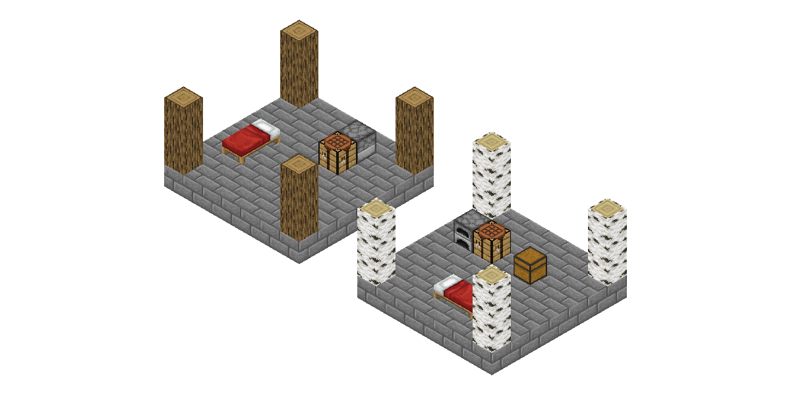

# Editing

Selections let you edit part of a region or transform a build as a whole. Start
with `output/workshop.schem` from the [developer quickstart](../quickstart/developers.md)
and make a rotated copy with birch pillars.

## Transform a copy

```python
from mcschemora import Schematic, block

scene = Schematic.load("output/workshop.schem")
region = scene.region()
area = region.select(start=(0, 0, 0), size=(7, 5, 7))
copy = area.duplicate(offset=(10, 0, 0))
copy.rotate(steps=1)
copy.replace("oak_log", block("birch_log", axis="y"))
scene.save("output/workshops.schem")
```

`duplicate` leaves the original in place and returns a selection of the copy.
Rotating that selection updates its coordinates and directional block states,
including the furnace and bed. Each step is a quarter turn around Y; one positive
step turns north toward west.

## Filters

Continue with the same scene:

```python
logs = area.select(block="oak_log")
print(logs.counts())
logs.patch(axis="y")
```

A filter can match block IDs, properties, or both. It records the matching
coordinates when you create the selection, then reads the current blocks at those
coordinates as you edit. Use `get_all()` when you need an independent snapshot.

## Fragments

```python
copy.flip(axis="x")
copy.move(offset=(0, 0, 10))
fragment = area.copy()
tower = scene.add_region("tower", origin=(40, 0, 0))
tower.set((0, 0, 0), fragment)
scene.save("output/regions.litematic")
```

`copy()` creates an independent fragment anchored at its minimum corner. Pasting
requires matching editions and Minecraft versions. Moving, rotating, and
mirroring reject occupied targets by default; pass `replace=True` when you
intend to overwrite them. Selected air can clear destination cells.

The transformed selection follows its new coordinates, while other selections keep
their own coordinates. You can rotate around Y and mirror across X or Z. Off-grid
results and unsupported state transforms raise an error before the change commits.

For whole-build replacements that retain compatible properties, use [palettes and
material profiles](palettes.md). Selection replacement writes the supplied target
block state.

## Selection contents

Filtered selections remember the matching coordinates at the time they are
created, without rerunning the filter after every edit. For example:

```python
logs = area.select(block="oak_log")
logs.replace("oak_log", block("birch_log", axis="y"))
print(logs.counts())
```

`logs` still selects the same cells and now reads birch logs. Create a fresh
filtered selection to find the current oak logs. `get_all()` returns an
independent dictionary of current non-air blocks. `counts()` groups full states;
`describe_layer(y=...)` returns a region-local text grid and state legend.
Text layers are limited to 65,536 cells of X/Z area.

## Collisions

Move, rotate, and mirror check for occupied targets outside the source selection
before changing the build. A move can overlap its own source cells; pass
`replace=True` to allow overwriting other destinations. Because selected air also
clears target cells, a bounding box containing mostly air can affect a large area.

Transformations validate coordinates, block states, and attached content before
committing. Unsupported state changes, off-grid pivots, or collisions raise an error.
Each call commits separately. An earlier edit remains applied if a later operation
fails.

Rotation supports quarter turns around Y; mirroring supports X and Z. A pivot or
mirror plane is in region-local coordinates. Custom pivots must map the integer
cell grid back onto itself. After the transformation, the selected coordinates
move with the content; other selection handles retain their own membership.

## Entities and deletion

`copy()` snapshots selected cells, attached data, and entities into an independent
fragment, anchored at its minimum selected corner. Pasting through `Region.set(at,
fragment)` requires matching Minecraft editions and versions. If versions differ,
convert the source and inspect its conversion losses first.

Copied free entities receive new references. `fill()` changes blocks while leaving
free entities unchanged. `delete()` clears selected blocks, their attached data, and
selected entities.

## Export transformed builds

The [rotation example](../examples/rotate-schematic.md) saves the transformed
coordinates and directional states, so another importer loads the rotated build.
Reload your output to inspect its block states and inventories, then test any
redstone mechanisms in-game: transforms do not simulate ticks.

## Run the example

[Download edit.py](../examples/downloads/edit.py) to make the rotated birch copy
with a preview. Give it the file from the quickstart:

```sh
uv run --with mcschemora edit.py output/workshop.schem
```

It writes `output/workshops.schem` and `output/workshops.png`, leaving the input
file untouched. The copied workshop contains 12 birch logs.

<details markdown="1">
<summary>Read edit.py</summary>

```python
--8<-- "examples/edit.py"
```

</details>



[Download the edited schematic](../assets/examples/workshops.schem){ .md-button }
