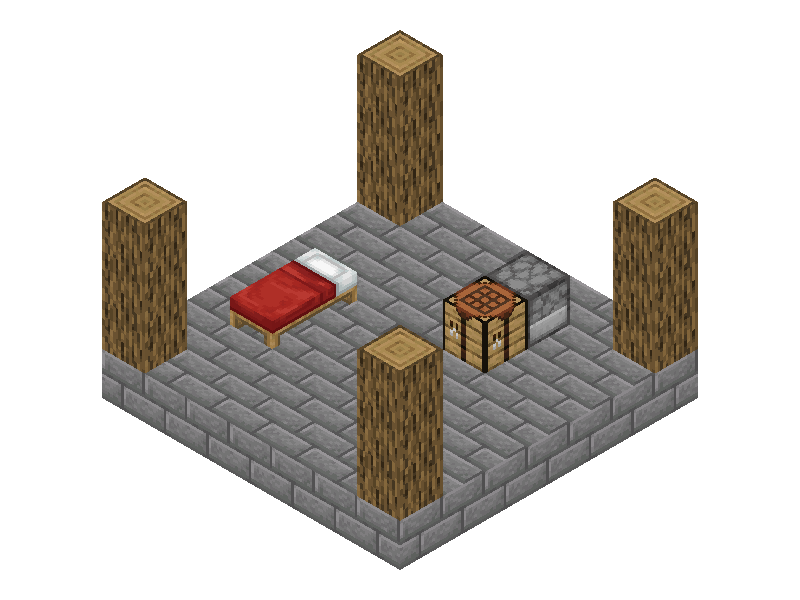
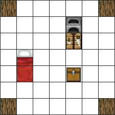

# Rendering

Render a schematic as a textured image or 3D model, or use sprite layers and
Wiki blueprints to make building guides. For a cutaway of the
[quickstart workshop](../quickstart/developers.md), load `output/workshop.schem`
and hide the roof.

## Textured PNGs

```python
from mcschemora import Schematic

scene = Schematic.load("output/workshop.schem")
diagnostics = scene.export_png("output/preview.png", size=(800, 600), y=(0, 3))
for diagnostic in diagnostics:
    print(diagnostic)
```

The default view is isometric, and `y=(0, 3)` shows the interior by hiding the
roof at Y=4. Cropping affects the image and leaves the schematic unchanged.

PNG and GLB rendering download visual assets on first use and temporarily
convert the palette for the shared Java 1.21.6 visual bundle. Review the returned
diagnostics for unsupported geometry and approximations, particularly with newer
blocks. See [versions and offline use](minecraft-data.md#rendering-coverage).

## Views and layers

```python
scene.export_png("output/top.png", view="top", grid=True, y=1)
```

Use `isometric`, `top`, `bottom`, `north`, `south`, `east`, or `west` for `view`.
Axis filters `x`, `y`, and `z` use global coordinates. A single integer selects one
layer; a pair includes both endpoints. Block selections use a cell count for `size`.

## 3D models

```python
diagnostics = scene.export_glb("output/workshop.glb")
print(diagnostics)
```

A compatible 3D viewer can open the GLB's model and textures. Keep the schematic
file as well if you need editable Minecraft block data.

## Sprite layers

```python
diagnostics = scene.export_sprites("output/layer.png", y=1, grid=True)
print(diagnostics)
```

Sprite diagrams use bundled Minecraft Wiki icons without downloading visual
assets. Because icons cannot represent every block state or attached field,
check the returned diagnostics for omitted data.

## Wiki blueprints

```python
diagnostics = scene.export_blueprint("output/workshop.wiki", name="Workshop")
print(diagnostics)
```

This writes layered-blueprint markup for Minecraft Wiki pages. It stores sprite
grids with less detail than a schematic. For input markup, provide an explicit
Minecraft version and check inferred defaults:

```python
from mcschemora import block

template = "{{layered blueprint|A=BlockSprite:stone|----Floor|A}}"
imported = Schematic.from_bytes(
    template.encode(),
    format="blueprint",
    version="1.21.1",
    palette={"A": block("stone")},
)
print(imported.import_diagnostics)
```

See [export_png](../reference/python.md#schematicexport_png),
[export_sprites](../reference/python.md#schematicexport_sprites), and
[from_bytes](../reference/python.md#schematicfrom_bytes) for all options.

## Coordinates and overlaps

Axis filters use global schematic coordinates even when `region=` selects one named
region. A tuple includes both endpoints. For a region at origin `(40, 0, 0)`, local
X=2 is filtered with `x=42`. Cropping leaves stored blocks, bounds, inventories, and
cost reports unchanged.

Identical blocks and attached data at a shared global position render once.
Conflicting overlapping content raises an error; select one region or resolve the
conflicts before rendering. Material-cost and inspection reports count each region's
stored placements, including overlaps.

## Image options

PNGs have a transparent background and accept integer dimensions from 1 through
4096 on each axis. Isometric and cardinal views are framed automatically, with
cardinal names describing the viewer's location. Use `threads=` to limit native
rasterizer workers; catalog loading and geometry preparation have separate workloads.

Use a region or axis crop for focused views of a large structure. Even a small image
can require preparing a large amount of geometry. `grid=True` draws block outlines,
with entities excluded from that outlined PNG mode.

## Layer guides

The [layer-guide example](../examples/layer-diagrams.md) calculates global Y
bounds across regions, writes one sprite PNG per layer, and records each file's
Y coordinate and diagnostics in a manifest. Empty gaps remain part of that
global sequence.

Sprites accept cardinal views, cell sizes from 1 to 128 pixels, grid lines,
optional entity icons, and overrides by block ID or full state string:

```python
diagnostics = scene.export_sprites(
    "output/stone-layer.png",
    y=0,
    grid=True,
    sprites={"minecraft:stone_bricks": "BlockSprite:stone"},
)
print(diagnostics)
```

An override changes the icon while keeping the build's material. Wiki import
`palette` maps symbols to blocks, and export `sprites` maps blocks to icons.
Use [normalization profiles](palettes.md) to change the materials themselves.

## Coverage

Textured outputs use a temporary conversion to the shared Java 1.21.6 visual bundle.
They do not change stored block states. Biome tints and unsupported geometry may be
approximated; diagnostics should accompany shared previews. Sprite/Wiki outputs can
omit orientations, attached inventories, entities, and other schematic data. Keep the
schematic file when sharing those details.

Native Python/Rust provide PNG, GLB, and sprite rendering. Browser WASM exposes
authoring and conversion but not these native render methods. Preparing visual
assets is separate from preparing ordinary catalogs and recipe data; see
[offline use](minecraft-data.md#offline-use).

## Run the example

[Download render.py](../examples/downloads/render.py) and run it on the file
from the quickstart:

```sh
uv run --with mcschemora render.py output/workshop.schem
```

It writes a textured cutaway, a Y=1 sprite layer, a GLB model, and a wiki blueprint
into `output/`. It prints diagnostics for details the outputs cannot represent,
including the inventory omitted by sprite and blueprint exports.

<details markdown="1">
<summary>Read render.py</summary>

```python
--8<-- "examples/render.py"
```

</details>

## Result





[Download the workshop model](../assets/examples/workshop.glb).
